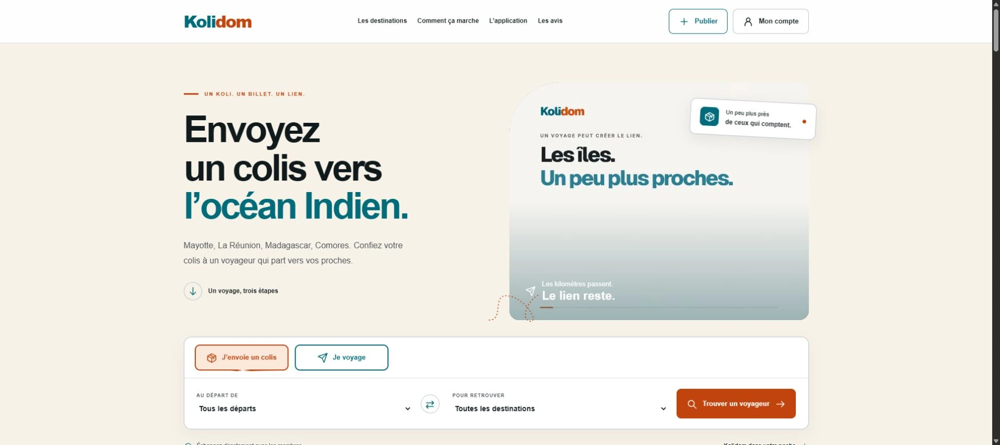
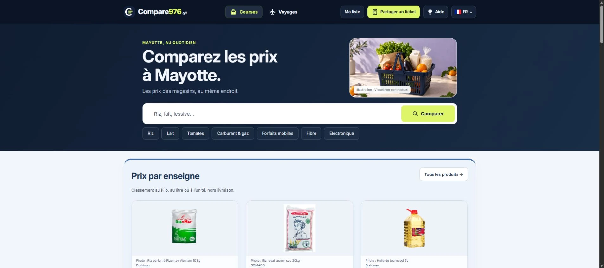

# Projets web et applications

Sites web, applications Android et outils numériques : retrouvez ici mes projets et les sites que j’accompagne avec **[Mo Repair](https://mo-repair.fr/)**.

[Voir le portfolio illustré](https://mo-repair.fr/realisations/) · [Prestations et contact](https://mo-repair.fr/presta/)

## Plateformes et applications

### [Kolidom](https://kolidom.fr/)

Kolidom permet de rechercher un trajet, de publier une annonce et d’échanger avec un membre pour organiser un envoi. Les trajets dépendent des annonces disponibles.

### [Compare976](https://compare976.yt/)

Compare976 rassemble une sélection de prix à Mayotte et permet de préparer une liste de courses. Les informations sont datées ; le prix actuel et la disponibilité se confirment auprès du vendeur. Le site ne vend pas les produits.

### [Docélio](https://mo-repair.fr/applications/docelio/)

Docélio est une application Android pour numériser des documents, utiliser la reconnaissance de texte et travailler sur ses PDF. La fiche Google Play présente les fonctionnalités et conditions actuelles.

[Fiche Android sur Google Play](https://play.google.com/store/apps/details?id=fr.docelio)

### [Mariamali 360](https://mariamali-360.fr/)

Mariamali 360 présente des outils pour organiser l’activité d’une société de livraison : colis, chauffeurs, planning, documents, facturation et suivi de gestion.

## Sites accompagnés

Ces sites présentent l’activité de leurs porteurs de projet. Chaque lien mène au site public, avec ses informations et modalités actuelles.

- **[Docs Archipel](https://docs-archipel.fr/)** — Des services pour préparer et suivre ses démarches administratives.
- **[Sakina Conseil](https://sakina-conseil.fr/)** — Un espace d’écoute et d’accompagnement en visio.
- **[Oriacolis](https://oriacolis.fr/)** — Achats et réexpédition de colis vers La Réunion et Mayotte.
- **[Hello Dubai Guide](https://hellodubaiguide.com/)** — Un guide pratique pour préparer son installation à Dubaï.
- **[Mamsalouva](https://mamsalouva.fr/)** — Mode et univers mahorais : salouvas, boubous, bijoux et beauté.
- **[SZ Doukani](https://souffouzdoukani.fr/)** — Une boutique de proximité à Acoua, Mayotte.
- **[20DZA-Draw](https://20dza-draw.yt/)** — Des toiles originales et un univers artistique autour de Mayotte.
- **[AC’TIF](https://ac-tif.yt/)** — Une association à Acoua autour du sport, de l’environnement et du lien social.

## Travailler ensemble

Pour un site, une application ou une automatisation, [présentez votre projet à Mo Repair](https://mo-repair.fr/contact.php). Le périmètre, le prix et l’acompte sont convenus au devis avant le démarrage.
